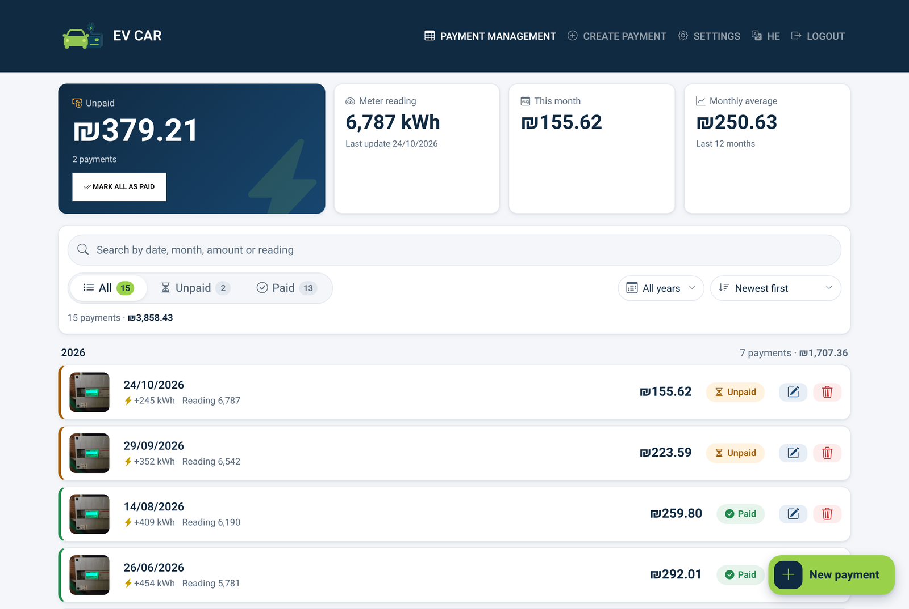
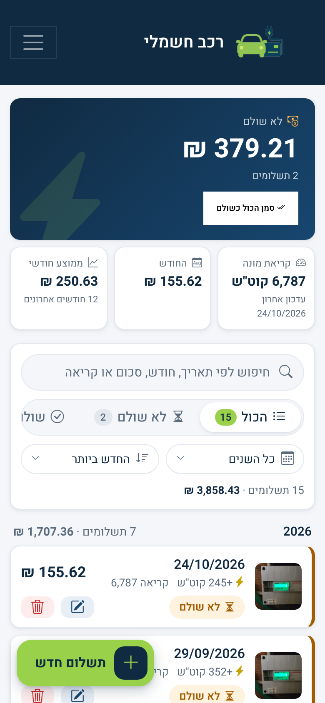
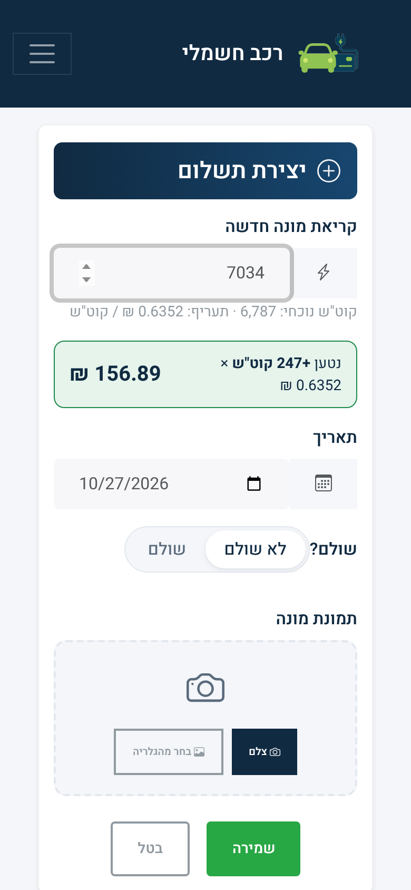
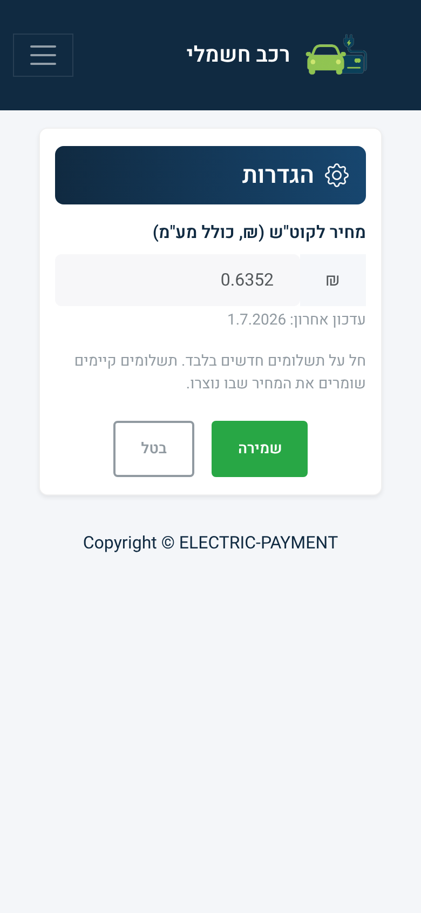

<div align="center">

# ⚡ Electric Payment

**Track the electricity cost of charging an EV at home: from a photo of the meter to who owes what.**

[](https://electric-payme.netlify.app/)
[](https://ivan954.github.io/Electric-Payment/)




</div>

## The problem

An electric car is charged from a dedicated meter at home, and the electricity is paid for by someone else. Every few weeks someone has to read the meter, work out how many kWh were used since the last reading, multiply by the current tariff, and keep track of what has and hasn't been paid. A shared spreadsheet and a folder of meter photos got messy, so I built this app instead.

## What it does

- **Snap and save.** Take a photo of the meter straight from the phone camera. It uploads in the background while you type the new reading.
- **Live price calculation.** The kWh charged since the previous reading and the cost show up while you type, using the current tariff.
- **Editable tariff.** The price per kWh is set from a Settings screen, not hard-coded. Each payment stores the rate it was billed at, so changing the tariff never rewrites history.
- **Dashboard.** See the total still unpaid (with one-tap *mark all as paid*), the latest meter reading, this month's cost and the 12-month average.
- **Search, filter, sort.** Search by date, month name, amount or reading. Filter by status and year, and sort by date, amount or usage. Filters live in the URL, so a refresh or a shared link keeps the same view.
- **Bilingual.** Hebrew (right-to-left) and English, switchable at runtime.
- **Mobile-first.** Designed for one-handed use on a phone, with a floating *New payment* button.
- **Public read, private write.** Anyone with the link can see the history. Adding, editing, deleting and changing settings require signing in.

## Screenshots

<table>
  <tr>
    <td align="center"><br><sub>Dashboard on mobile (Hebrew, RTL)</sub></td>
    <td align="center"><br><sub>New payment with live price</sub></td>
    <td align="center"><br><sub>Tariff settings (signed-in only)</sub></td>
    <td align="center"><br><sub>Mobile navigation</sub></td>
  </tr>
</table>

<sub>Screenshots use demo data.</sub>

## Tech stack

| Layer | Choice |
|---|---|
| UI | React 18 (Create React App), React Router 6, React-Bootstrap with the Bootswatch *Lux* theme, Bootstrap Icons |
| State | Redux + redux-thunk; React context for auth and i18n |
| Backend | Firebase Authentication, Cloud Firestore, Cloud Storage. No custom server. |
| Hosting | Netlify (auto-deploys from `main`), mirrored on GitHub Pages |

### Design notes

- **Price is a snapshot, not a formula.** `price = (new reading − previous reading) × rate`, and both `price` and `pricePerKwh` are stored on the payment when it's created. Changing the tariff in Settings only affects new entries. Editing an old entry's reading reprices only the difference, at that entry's own rate.
- **Optimistic updates.** Toggling paid/unpaid updates the UI immediately and writes through a Firestore batch. If the write fails, the change is rolled back.
- **Uploads before submit.** The meter photo uploads as soon as it's picked, so saving is instant. If the form is abandoned, the orphaned file is deleted from Storage.
- **Lazy images.** Meter thumbnails load only when they scroll into view, using `IntersectionObserver`.
- **Routing on any host.** The router uses `PUBLIC_URL` as its basename, so the same code runs at the root on Netlify and under `/Electric-Payment` on GitHub Pages. Each host gets an SPA fallback: `_redirects` on Netlify, `404.html` on Pages.

## Getting started

Requires Node.js 18 or later.

```bash
git clone https://github.com/ivan954/Electric-Payment.git
cd Electric-Payment
npm install
npm start          # http://localhost:3000
```

The app connects to the Firebase project configured in [`src/firebase.js`](src/firebase.js). To run it against your own project, replace that config, enable Email/Password sign-in, and create the collections described below.

| Command | What it does |
|---|---|
| `npm start` | Development server with hot reload |
| `npm run build` | Production build into `build/` |
| `npm run deploy:gh-pages` | Build for GitHub Pages and publish to the `gh-pages` branch |
| `npm test` | Test runner |

**Debugging in VS Code:** [`.vscode/launch.json`](.vscode/launch.json) has a **Debug app** configuration. Press `F5` to start the dev server and attach Chrome, so breakpoints in `src/` work. In development the Redux store is also exposed in the browser console as `window.store`.

## Data model

**`payments/{id}`**

| Field | Type | Example |
|---|---|---|
| `KWH` | number | `9083`: cumulative meter reading, not usage |
| `date` | string | `"2026-10-14"` (`YYYY-MM-DD`) |
| `price` | number | `112.29` |
| `pricePerKwh` | number | `0.6352`: rate this payment was billed at (older entries without it were billed at `0.57`) |
| `paid` | string | `"Yes"` / `"No"` |
| `image` | string | Storage download URL of the meter photo |
| `updateTime` | timestamp | |

**`KWH/{id}`** mirrors `KWH` and `date` under the same id as the payment, and is used to find the current (highest) meter reading.

**`settings/pricing`** holds `{ pricePerKwh, updatedAt }`, the tariff applied to new payments. If it's missing, the app falls back to `DEFAULT_PRICE_PER_KWH` in [`src/utils/pricing.js`](src/utils/pricing.js).

## Project structure

```
src/
├── App.js                  routes; RequireAuth guards /create, /manage/:id and /settings
├── firebase.js             Firebase app, auth, Firestore and Storage instances
├── store.js                Redux store
├── actions/                Firestore reads/writes dispatched as Redux actions
├── reducers/ constants/    Redux state and action types
├── contexts/
│   ├── AuthContext.js      signed-in user (onAuthStateChanged)
│   └── I18nContext.js      Hebrew/English strings and text direction
├── hooks/usePricing.js     current tariff from settings/pricing
├── screens/                Manage (home), Create, Update, Settings, Login
├── components/             SummaryCards, PaymentFilters, PaymentCard, Header, LazyImage, Loader, …
└── utils/
    ├── payments.js         usage, summaries, search/sort/grouping, formatting
    └── pricing.js          tariff defaults, load/save, per-payment rate
```

## Security

- No passwords, tokens or service-account keys are stored in this repository. Sign-in uses Firebase Authentication.
- The values in `src/firebase.js` are Firebase's **web client config**. They identify the project to the browser SDK and are public by design: every Firebase web app ships them to the browser. Access is enforced by Firestore and Storage **security rules**, which should allow public reads and restrict writes to authenticated users.
- `.env` is git-ignored. Use it for any local-only overrides.

## Deployment

- **Netlify:** builds every push to `main` using [`netlify.toml`](netlify.toml) (`npm run build`, publishing `build/`, with `CI=false` so a Bootstrap autoprefixer notice doesn't fail the build).
- **GitHub Pages:** `npm run deploy:gh-pages`. The Pages domain must be listed under Firebase Console → Authentication → Settings → **Authorized domains** for sign-in to work there.
